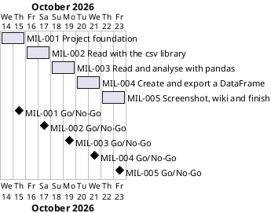

# Project Plan: Weather Data (Day 25)

## Metadata
| Key | Value |
| --- | --- |
| ID | PP-001 |
| CrossReference | [BC-001], [SA-001], [DICT-001], [MIL-001], [MIL-002], [MIL-003], [MIL-004], [MIL-005] |
| Language | en |
| Domain | it |

## Version History
| Date | Status | Author | Reviewer | Change | Commit |
| --- | --- | --- | --- | --- | --- |
| 2026-10-13 | Accepted | Jens Tirsvad Nielsen | S01 | Initial version; accepted by S01 (Product Owner) in chat on 2026-10-13 | [165e91a] |

---

## Purpose

This plan schedules the five milestones that deliver the Weather Data (Day 25) repository of [BC-001]. The milestones set up the repository, read the weather file with the `csv` library, read and analyse it with `pandas`, create and export a `DataFrame` with a main flow that prints the results, and finish the repository with a screenshot, a wiki in three languages and an end-to-end check. Each milestone is one gateway document, one branch and one pull request, so that every step is kept track of and reviewed before the next one starts.

## Planning Assumptions

- The phase starts 2026-10-14 and ends by 2026-10-23. All dates are proposed and need the Product Owner's confirmation (see Open Issues).
- Phase length: two days per milestone, sized for the spare time of S01, who owns every phase ([SA-001]).
- One branch per milestone, named after it (`mil-001-project-foundation` and so on), and one pull request that closes the issues of that milestone with one `Closes #N` line each. The planning documents themselves are delivered on the branch `plan-baseline`.
- S01 switched on autonomous mode in chat on 2026-10-13 (see `AGENTS.md`, Modes): S01's acceptance of this plan is the request, and the commit, the push, the pull request and its merge follow without further asking. The reviews are done by the assistant as stand-in for S01 and are not independent; each record says `Mode: autonomous, not independent`.
- The plan gate is enabled for commits in this clone: a commit that changes `src/` or `tests/` needs a `Task: MIL-NNN#N` trailer for an accepted, reviewed milestone.
- The tokens in `.env` are used only by commands that the assistant runs (repository description and topics, sync of issues); the project never imports, tests or tracks the file.
- The lecture summaries in the request (reading CSV data, then `DataFrame` and `Series`) are the specification; the two lectures are planned together because the second continues the first.

## Gateway Schedule

| Gateway | Document | Window | Decision date | Owner | Stories | Main deliverable | Milestone |
| --- | --- | --- | --- | --- | --- | --- | --- |
| Project foundation | [MIL-001] | 2026-10-14 to 2026-10-15 | 2026-10-15 | S01 | None (see Open Issues) | `pyproject.toml`, `.gitignore`, `constants.py`, README, `Doxyfile`, CI workflow, repository description and topics | |
| Read with the csv library | [MIL-002] | 2026-10-16 to 2026-10-17 | 2026-10-17 | S01 | None (see Open Issues) | `weather_data.csv`, `read_rows` and `read_temperatures`, with tests | |
| Read and analyse with pandas | [MIL-003] | 2026-10-18 to 2026-10-19 | 2026-10-19 | S01 | None (see Open Issues) | `read_data`, conversions, average, maximum, row selection, Fahrenheit, with tests | |
| Create and export a DataFrame | [MIL-004] | 2026-10-20 to 2026-10-21 | 2026-10-21 | S01 | None (see Open Issues) | `create_scores_frame`, `export_frame`, `python -m weather`, with tests | |
| Screenshot, wiki and finish | [MIL-005] | 2026-10-22 to 2026-10-23 | 2026-10-23 | S01 | None (see Open Issues) | Screenshot in README and wiki; wiki in English, Danish and Bahasa Melayu; end-to-end verification | |



## Scope Coverage

| Business Case scope item | Gateway |
| --- | --- |
| Constants in `constants.py`; `src/`, `tests/`, `docs/` layout | [MIL-001], extended in [MIL-002] to [MIL-004] |
| `pyproject.toml`, Python `.gitignore`, `Doxyfile`, README, continuous integration workflow | [MIL-001], README finished in [MIL-005] |
| Repository description and topics | [MIL-001] (task 7), checked again in [MIL-005] |
| The data file `weather_data.csv` | [MIL-002] |
| Lecture "Reading CSV data": reading with the `csv` library, temperatures as integers | [MIL-002] |
| Lecture "Reading CSV data": reading with `pandas` in one line | [MIL-003] |
| Lecture "DataFrame and Series": types, `to_dict`, `to_list`, average, maximum, row selection, Fahrenheit | [MIL-003] |
| Lecture "DataFrame and Series": creating a `DataFrame` from a dictionary and exporting it with `to_csv` | [MIL-004] |
| A main flow that prints the results | [MIL-004] |
| Screenshot in the README and on the wiki | [MIL-005] |
| Wiki in English, Danish and Bahasa Melayu | [MIL-005] |

## Dependencies

```
MIL-001 → MIL-002 → MIL-003 → MIL-004 → MIL-005
```

A No-Go on a gateway returns it to S01 for rework and moves every later date by the same number of days; no buffer day is planned.

## Plan Risks

| Risk | Impact | Mitigation |
| --- | --- | --- |
| The planning documents take longer to review than the work left on the code | The first gateway slips | Review [BC-001], [SA-001] and this plan together in one sitting; keep the milestones small |
| Author and reviewer are the same person (S01) | A review can miss a defect | Use the QC checklists and the pull request as the second look; recorded in [BC-001] |
| The git host has no Actions runner | The CI workflow is never executed | Run the same commands locally before each pull request |
| Lecture details are only available as the summaries in the request | The code differs from the video | S01 compares the finished program with the video at the [MIL-003] and [MIL-004] Go/No-Go |
| The sync matches issues by title, so a title used twice overwrites an issue | A task disappears from the board | Every task title is unique across all milestones; check before each `--apply` |
| `pandas` does not install on Python 3.13 on a platform | The `pandas` milestones cannot be tested there | `pandas` is an extra, the `csv` part stays testable; reported, not worked around |
| The screenshot is a capture of a real terminal window, which needs a display | It cannot be repeated in CI | Taken once on S01's machine with a one-off script outside the repository and committed as a file |
| The wiki publish workflow needs a secret of the organization | The wiki stays empty | Reported to S01, never worked around; the pages are files in `wiki/` and are not lost |

## Open Issues

- **Dates:** the start date, milestone lengths and the end date 2026-10-23 are proposed and not given by the Product Owner; confirm or replace them.
- **Product Owner (PO) language:** English, recorded as `en` in `docs/artifact-registry.md` (the request and the other repositories of the course are in English); confirm.
- **Stakeholder levels:** the Power and Interest levels of S02 and S03 in [SA-001] are proposals.
- **Repository:** the request names the organization page `https://git.tirsystem.com/Tirsvad-Udemy-100_days_of_code` (underscores). The repository of `origin` is `Tirsvad-Udemy-100-days-of-code/025-weather`, already created and empty; the description and topics are set there.
- **Working folder:** the session started in `024-snake` (a finished project); the work is done in the `025-weather` clone, which S01 selected in chat.
- **`pandas` and "no runtime dependencies":** the lectures need `pandas`. The plan keeps `[project].dependencies` empty and makes `pandas` an optional extra (also in `dev`), so S03 gets a `csv` part with nothing to install. The alternative is `pandas` as a normal dependency. Confirm.
- **Place of the data file:** `weather_data.csv` is kept next to the code in `src/weather/`, so the default path works from any folder and the layout stays `src/`, `tests/`, `docs/`. Confirm, or ask for a `data/` folder.
- **Names:** the lectures use script variables, not functions. The functions of the plan (`read_rows`, `read_temperatures`, `read_data`, `to_data_dict`, `to_temp_list`, `average_temp`, `average_temp_mean`, `max_temp`, `row_for_day`, `hottest_row`, `day_in_fahrenheit`, `create_scores_frame`, `export_frame`) are proposals that wrap the lectures' expressions; the lectures' variable names are used inside them. Confirm.
- **"Python greater than 3.13":** read as Python 3.13 or newer (`requires-python = ">=3.13"`). Confirm.
- **README template:** the Product Owner's README template is used. It differs from `framework/templates/README-template.md`, so `framework/scripts/check-readme.sh` stays off.
- **Screenshot:** the program is a command-line program, so the screenshot is of a terminal window running `python -m weather`, not of a graphical window. Confirm.
- **No user story or use case:** the tasks are written as build and check steps, so they are plain technical tasks.
- **Governance and traceability matrix:** `GOV` and `TM` do not exist in this project; the plan proceeds without them and records each review as an `RC-*`.
- **Diagram check:** the Gantt chart above was not rendered because no PlantUML server is configured (`PLANTUML_URL`); render it before the review.
- **Sync:** `sync-project.sh --apply` is run with `GITEA_TOKEN` from the personal `.env` after the plan is accepted; the sync matches issues by title.

---

[BC-001]: ./business-case.md
[SA-001]: ./stakeholder-analysis.md
[DICT-001]: ./dictionary.md
[MIL-001]: ./milestones/mil-001-project-foundation.md
[MIL-002]: ./milestones/mil-002-read-with-csv.md
[MIL-003]: ./milestones/mil-003-pandas-analysis.md
[MIL-004]: ./milestones/mil-004-create-and-export.md
[MIL-005]: ./milestones/mil-005-screenshot-wiki-and-finish.md
[165e91a]: https://git.tirsystem.com/Tirsvad-Udemy-100-days-of-code/025-weather/commit/165e91a0183c6351fbfdad53b050bb2918275e6d
